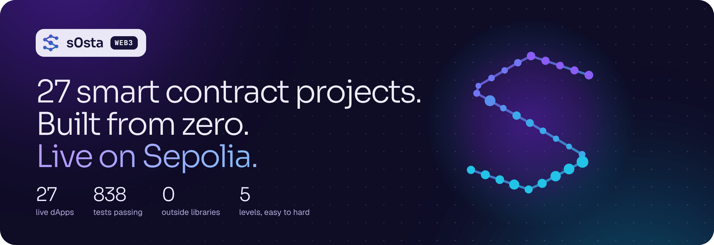
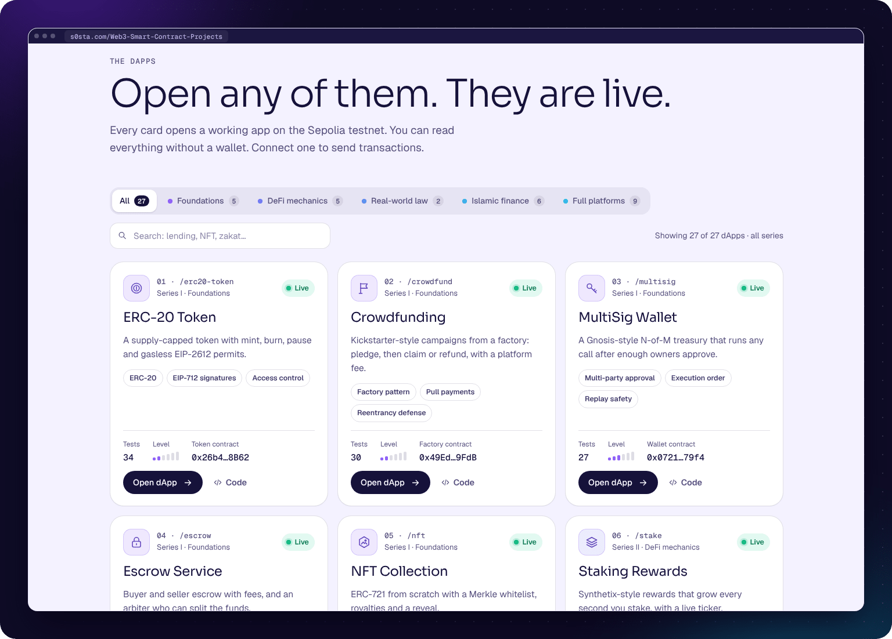

<div align="center">

<a href="https://s0sta.com/Web3-Smart-Contract-Projects/"></a>

<br>

<a href="https://github.com/s0sta/Web3-Smart-Contract-Projects/actions/workflows/ci.yml"></a>


<a href="https://s0sta.com/Web3-Smart-Contract-Projects/"></a>


### 28 smart contract projects, from a simple token to full platforms.

Each one has the contracts, the tests, a deploy script and a web app you can try.

**[Try the live apps](https://s0sta.com/Web3-Smart-Contract-Projects/)** · **[All projects](#the-28-projects)** · **[Run the tests](#run-it-on-your-computer)** · **[Security](SECURITY.md)**

</div>

<br>

## What is this?

A portfolio of **Solidity smart contracts written from zero**: no OpenZeppelin and no outside libraries in the contracts.
Each project is tested from an attacker's point of view, and each one has a **live web app on the Sepolia test network**.

The projects go from **easy to hard** in 5 levels:

| Level | Projects | What you learn |
|:--|:--:|:--|
| 🧱 **1 · Foundations** | 01 – 05 | Tokens, NFTs, crowdfunding, escrow, multisig wallets |
| ⚙️ **2 · DeFi basics** | 06 – 10 | Staking, vesting, a DEX, a DAO, lending |
| 🏛️ **3 · Real-world law** | 11 – 12 | Owners associations and property shares (Dubai) |
| 🕌 **4 · Islamic finance** | 13 – 18 | Waqf, sukuk, takaful, murabaha, zakat, a regulated treasury |
| 🏢 **5 · Full platforms** | 19 – 28 | Banking, exchange, payments, identity, supply chain, insurance, giving, energy, health |

<p align="center">
  <a href="https://s0sta.com/Web3-Smart-Contract-Projects/"></a>
</p>

## The 28 projects

Click a project name to see its code. **App** opens the live web app. **Contract** opens the main contract on Sepolia Etherscan.

### 🧱 Level 1 · Foundations

The basics: a token, crowdfunding, a multisig wallet, escrow and NFTs.

| # | Project | What it does | Tests | Try it |
|:--:|:--|:--|:--:|:--|
| 01 | [**ERC-20 Token**](01-erc20-token/) | A supply-capped token with mint, burn, pause and gasless EIP-2612 permits. | 34 | [App](https://s0sta.com/Web3-Smart-Contract-Projects/erc20-token/) · [Contract](https://sepolia.etherscan.io/address/0x26b420683E6F6Df39CFceBd7C5bB78B7459b8B62) |
| 02 | [**Crowdfunding**](02-crowdfunding/) | Kickstarter-style campaigns from a factory: pledge, then claim or refund, with a platform fee. | 30 | [App](https://s0sta.com/Web3-Smart-Contract-Projects/crowdfund/) · [Contract](https://sepolia.etherscan.io/address/0x49Ed445AB73b0397B8946c6BCDCa4bFcF04C9FdB) |
| 03 | [**MultiSig Wallet**](03-multisig-wallet/) | A Gnosis-style N-of-M treasury that runs any call after enough owners approve. | 27 | [App](https://s0sta.com/Web3-Smart-Contract-Projects/multisig/) · [Contract](https://sepolia.etherscan.io/address/0x07212677caE6aa93331d6E18205EB5898c3079f4) |
| 04 | [**Escrow Service**](04-escrow-service/) | Buyer and seller escrow with fees, and an arbiter who can split the funds. | 31 | [App](https://s0sta.com/Web3-Smart-Contract-Projects/escrow/) · [Contract](https://sepolia.etherscan.io/address/0xC1b5B1dcd8985c9965C2E7Ac8E4A1a3b85394564) |
| 05 | [**NFT Collection**](05-nft-collection/) | ERC-721 from scratch with a Merkle whitelist, royalties and a reveal. | 33 | [App](https://s0sta.com/Web3-Smart-Contract-Projects/nft/) · [Contract](https://sepolia.etherscan.io/address/0x57446cB7B0E8ac94892A5cB2b61C8cb377BC7Fea) |

### ⚙️ Level 2 · DeFi basics

How DeFi works: staking rewards, vesting, a DEX, a DAO and lending.

| # | Project | What it does | Tests | Try it |
|:--:|:--|:--|:--:|:--|
| 06 | [**Staking Rewards**](06-staking-rewards/) | Synthetix-style rewards that grow every second you stake, with a live ticker. | 26 | [App](https://s0sta.com/Web3-Smart-Contract-Projects/stake/) · [Contract](https://sepolia.etherscan.io/address/0xacc9353CecE7344064b20060A712C7B6A8f8450e) |
| 07 | [**Token Vesting**](07-token-vesting/) | Cliff and linear vesting schedules that the owner can revoke. | 20 | [App](https://s0sta.com/Web3-Smart-Contract-Projects/vesting/) · [Contract](https://sepolia.etherscan.io/address/0xCf406a9b6EF721B38421eFd9860Af921E765B935) |
| 08 | [**AMM DEX**](08-amm-dex/) | A Uniswap-V2-style factory, pairs and router, with flash swaps. | 21 | [App](https://s0sta.com/Web3-Smart-Contract-Projects/dex/) · [Contract](https://sepolia.etherscan.io/address/0xD7C530a1025A70e1932A1554932B35317496F819) |
| 09 | [**DAO Governance**](09-dao-governance/) | Snapshot voting power, quorum and on-chain execution of proposals. | 16 | [App](https://s0sta.com/Web3-Smart-Contract-Projects/dao/) · [Contract](https://sepolia.etherscan.io/address/0x9a9Cb0c2Ac2A08d3A4590Aaa1B5637A16dDBcC48) |
| 10 | [**Lending Protocol**](10-lending-protocol/) | Borrow against collateral, pay interest, and get liquidated when the health factor drops. | 23 | [App](https://s0sta.com/Web3-Smart-Contract-Projects/lend/) · [Contract](https://sepolia.etherscan.io/address/0x330FE254EbB65fFf03CA4E0814B288DffaA79e34) |

### 🏛️ Level 3 · Real-world law

Real laws written as code: Dubai owners associations and DLD/RERA property shares.

| # | Project | What it does | Tests | Try it |
|:--:|:--|:--|:--:|:--|
| 11 | [**Owners Association**](11-owners-association/) | Dubai Law No. 6 of 2019 on-chain: unit registry, service charges, board and veto. | 48 | [App](https://s0sta.com/Web3-Smart-Contract-Projects/hoa/) · [Contract](https://sepolia.etherscan.io/address/0xFeD940A0435816f3f190f99737676F6A62Ba4228) |
| 12 | [**Estate Tokenization**](12-realestate-tokenization/) | DLD/RERA property shares with KYC, rental income and a maintenance reserve. | 20 | [App](https://s0sta.com/Web3-Smart-Contract-Projects/estate/) · [Contract](https://sepolia.etherscan.io/address/0x12dd8571779A707E931471c38D631D8542046180) |

### 🕌 Level 4 · Islamic finance

Waqf, sukuk, takaful, murabaha and zakat, plus a VARA-style regulated treasury.

| # | Project | What it does | Tests | Try it |
|:--:|:--|:--|:--:|:--|
| 13 | [**Waqf Endowment**](13-waqf-endowment/) | A corpus that can never be spent. Only its income goes to charity. | 46 | [App](https://s0sta.com/Web3-Smart-Contract-Projects/waqf/) · [Contract](https://sepolia.etherscan.io/address/0x3dc6d47de5f14f562b4bee02417d2fa51cab1c19) |
| 14 | [**VARA Treasury**](14-vara-treasury/) | Regulated custody: segregated funds, KYC limits and a capital reserve. | 29 | [App](https://s0sta.com/Web3-Smart-Contract-Projects/vara/) · [Contract](https://sepolia.etherscan.io/address/0xfB14587cd6bd501Ac4e53b65904D08d597950818) |
| 15 | [**Sukuk Vault**](15-sukuk-vault/) | Ijarah sukuk: certificates backed by a leased asset, with Shariah-approved profit. | 21 | [App](https://s0sta.com/Web3-Smart-Contract-Projects/sukuk/) · [Contract](https://sepolia.etherscan.io/address/0xAb1b72EEA7D7842dfA48e7d44B7C21E153DA0bd7) |
| 16 | [**Takaful Insurance**](16-takaful-insurance/) | Mutual insurance pools with a claims committee and a no-claim surplus. | 18 | [App](https://s0sta.com/Web3-Smart-Contract-Projects/takaful/) · [Contract](https://sepolia.etherscan.io/address/0xe0528967d4bB5C4Ccd02d64cEa3b7D57367dA238) |
| 17 | [**Murabaha Finance**](17-murabaha-finance/) | Cost-plus trade finance with a disclosed markup, installments and charity late fees. | 16 | [App](https://s0sta.com/Web3-Smart-Contract-Projects/murabaha/) · [Contract](https://sepolia.etherscan.io/address/0xa293EBb6e86718f5A2E9c53403E38f698824e751) |
| 18 | [**Zakat Engine**](18-zakat-engine/) | Nisab and hawl, 2.5 percent, and the eight asnaf of Quran 9:60. | 22 | [App](https://s0sta.com/Web3-Smart-Contract-Projects/zakat/) · [Contract](https://sepolia.etherscan.io/address/0x2B5fF4f15DdccA62233B06225b34DE5f93718495) |

### 🏢 Level 5 · Full platforms

Nine complete platforms, from banking to energy. Each one has 9 to 13 contracts that work together.

| # | Project | What it does | Tests | Try it |
|:--:|:--|:--|:--:|:--|
| 19 | [**Mawarid RWA**](19-mawarid-rwa/) | Tokenized real estate end to end: issuance, exchange, rent, governance and insurance. | 53 | [App](https://s0sta.com/Web3-Smart-Contract-Projects/mawarid/) · [Contract](https://sepolia.etherscan.io/address/0x7A688e184ab92b97a0062fA0A752E07974627C50) |
| 20 | [**Tamweel Credit**](20-tamweel-credit/) | A complete digital bank: deposits, credit lines, loans, auctions and governance. | 47 | [App](https://s0sta.com/Web3-Smart-Contract-Projects/tamweel/) · [Contract](https://sepolia.etherscan.io/address/0x8F05B5167decaD8266f01C11f333AAAA475C19bD) |
| 21 | [**Sahm Exchange**](21-sahm-exchange/) | An exchange with an order book, AMM pools, leveraged margin and circuit breakers. | 45 | [App](https://s0sta.com/Web3-Smart-Contract-Projects/sahm/) · [Contract](https://sepolia.etherscan.io/address/0xb438AbC481c3888C83fcDcE7143ED087F724B77b) |
| 22 | [**Rahala Payments**](22-rahala-payments/) | Cross-border payments: FX, escrow, invoice factoring, netting and arbitration. | 37 | [App](https://s0sta.com/Web3-Smart-Contract-Projects/rahala/) · [Contract](https://sepolia.etherscan.io/address/0x084353D5F680651deDa34073AF768E014E912A6E) |
| 23 | [**Huwiyya Identity**](23-huwiyya-identity/) | Decentralized IDs, verifiable credentials, selective disclosure and recovery. | 31 | [App](https://s0sta.com/Web3-Smart-Contract-Projects/huwiyya/) · [Contract](https://sepolia.etherscan.io/address/0x77701d73b4615715f3767E5ca308EB07Eb0A8Ae9) |
| 24 | [**Silsila Supply Chain**](24-silsila-supplychain/) | Purchase orders, shipment tracking, quality checks and milestone payments. | 43 | [App](https://s0sta.com/Web3-Smart-Contract-Projects/silsila/) · [Contract](https://sepolia.etherscan.io/address/0x62D09186787FE0af9F34724022DB26795F10812c) |
| 25 | [**Daman Insurance**](25-daman-insurance/) | Actuarial pricing, claims, parametric payouts, reinsurance and surplus. | 34 | [App](https://s0sta.com/Web3-Smart-Contract-Projects/daman/) · [Contract](https://sepolia.etherscan.io/address/0x0476a7b394C8325B810790B765bDEb909dc71cA9) |
| 26 | [**Ataa Giving**](26-ataa-giving/) | Zakat on 7 asset classes, sadaqa, campaigns, sponsorships and donor tracking. | 36 | [App](https://s0sta.com/Web3-Smart-Contract-Projects/ataa/) · [Contract](https://sepolia.etherscan.io/address/0xeE9fd5f7b8Eb2250963F3d948fEcfc62D5A02018) |
| 27 | [**Taqa Energy**](26-taqa-energy/) | Renewable-energy certificates, carbon credits and peer-to-peer energy trading. | 31 | [App](https://s0sta.com/Web3-Smart-Contract-Projects/taqa/) · [Contract](https://sepolia.etherscan.io/address/0xc183fA1628d408D63b754aA9F5A8bAFF0167fb25) |
| 28 | [**Shifa Health**](28-shifa-healthcare/) | Patient-owned medical records, consent, e-prescriptions, visits and health-insurance claims. | 76 | [App](https://s0sta.com/Web3-Smart-Contract-Projects/shifa/) · [Contract](https://sepolia.etherscan.io/address/0xB4A139e894c752765d0c2FD69CBE538f1013cA20) |

## Run it on your computer

Every project is its own small [Foundry](https://getfoundry.sh/) project. The test library (`forge-std`) is already inside each folder, so there is nothing else to install.

```bash
# 1. Install Foundry (one time)
curl -L https://foundry.paradigm.xyz | bash
foundryup

# 2. Get the code
git clone https://github.com/s0sta/Web3-Smart-Contract-Projects.git
cd Web3-Smart-Contract-Projects/01-erc20-token

# 3. Build and run the tests
forge build
forge test
```

Change `01-erc20-token` to any other project folder to test that project.
GitHub Actions also builds and tests **all 28 projects** on every push ([see the runs](https://github.com/s0sta/Web3-Smart-Contract-Projects/actions/workflows/ci.yml)).

## What is in each project folder

```text
01-erc20-token/
├── src/         the smart contracts
├── test/        the tests
├── script/      the deploy script
├── frontend/    the web app (HTML, CSS and JavaScript)
└── README.md    how it works, design choices and limits
```

## How every project is made

1. **Write the rules first.** What must never break? For example: "the total supply never goes over the cap".
2. **Write the contract from zero**, with clear errors and comments.
3. **Test it like an attacker.** Unit tests, plus fuzz tests and attack tests where they matter. For example, projects 02 and 04 run a real reentrancy attack, and 09 tries flash-loan vote buying. The tests prove that these attacks fail.
4. **Deploy it to Sepolia** and build a web app for it.
5. **Check it on every push** with GitHub Actions.

## Security

> [!WARNING]
> These contracts are for **learning and portfolio** use and run on the **Sepolia test network**.
> They have **not had an independent audit**. Do not use them with real money without one.
> To report a problem, read [SECURITY.md](SECURITY.md).

## License

MIT. Every Solidity file carries the MIT license line.

<br>

<div align="center">

Made by **[Hosam Hani (s0sta)](https://github.com/s0sta)** · [s0sta.com](https://s0sta.com) · [LinkedIn](https://www.linkedin.com/in/hosam-hani-abdelati/) · [X](https://x.com/s0sta_)

Need a smart contract audit or a new protocol? → **[Send a request](https://s0sta.com/Web3-Smart-Contract-Projects/#work)**

</div>
